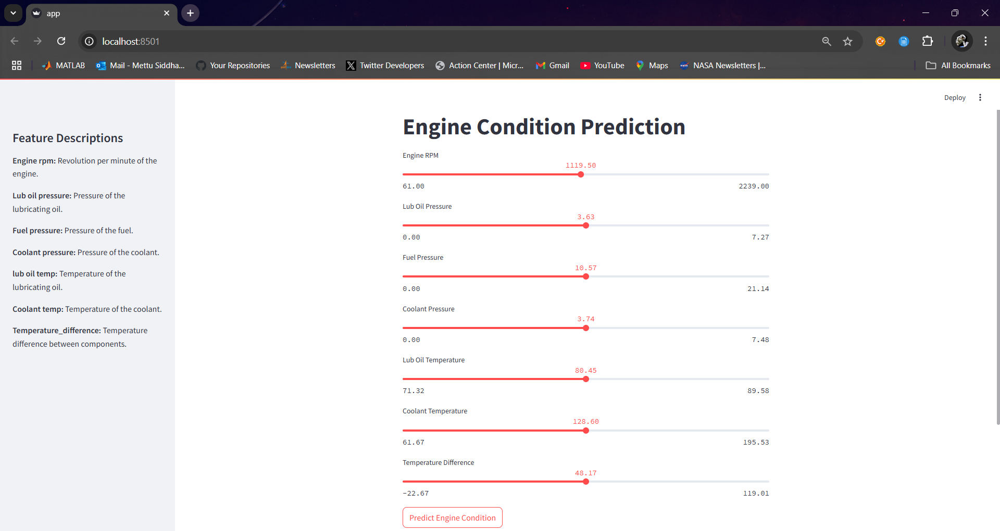
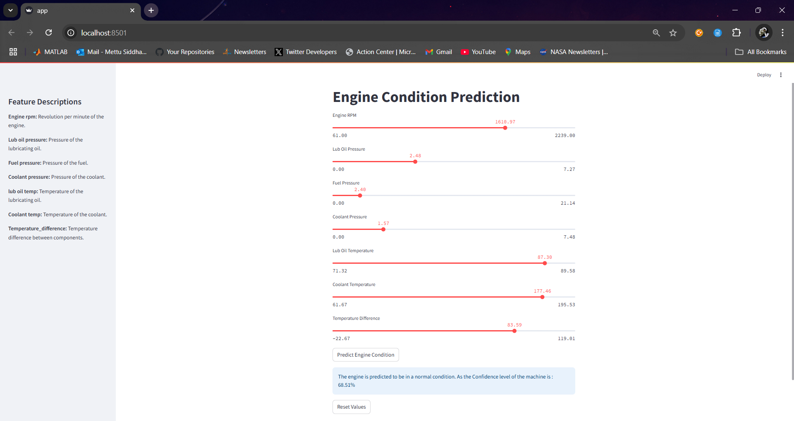
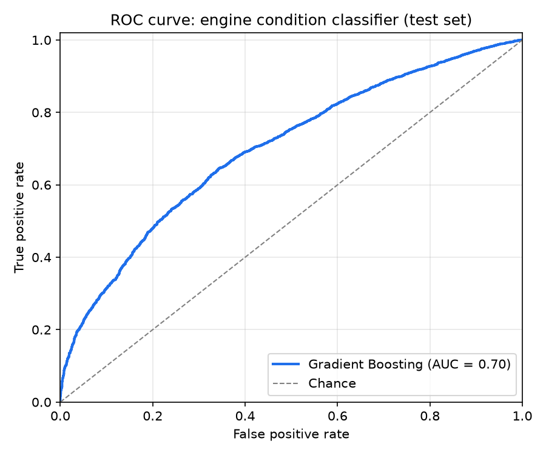
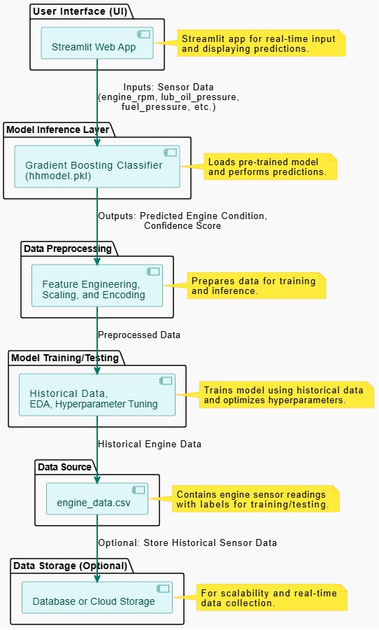

# AI-Powered Predictive Maintenance for Vehicles


A machine learning project that classifies engine condition from sensor readings and serves the model through an interactive Streamlit app. A Gradient Boosting classifier is trained on **19,535 engine sensor records**, and the app lets you adjust each reading and see the predicted condition along with the model's probability.

> **Scope:** this is an educational / portfolio project built on a static dataset. It is a baseline model, not a production diagnostic system. See [Results](#results) and [Limitations](#limitations) for an honest look at performance.

## Demo

| Sensor inputs | Prediction |
|:---:|:---:|
|  |  |

Run the app locally with `streamlit run app/app.py` (see [Getting Started](#getting-started)).

## Features

- **Exploratory analysis and feature engineering** in a Jupyter notebook, including a derived `Temperature_difference` feature (coolant temp minus lubricating-oil temp).
- **Gradient Boosting classifier** trained on six sensor readings plus the derived feature.
- **Interactive Streamlit app** with a slider per sensor, a one-click prediction, and a reset button. The result shows the predicted class and the model's probability for it.
- **Reproducible training:** `src/train_model.py` rebuilds the model and the evaluation metrics from the raw CSV in one command.

## Dataset

`Data/engine_data.csv`: **19,535 rows**, no missing values, no duplicate rows.

| Column | Role | Observed range |
|--------|------|----------------|
| `Engine rpm` | Feature | 61 to 2,239 |
| `Lub oil pressure` | Feature | 0.003 to 7.27 |
| `Fuel pressure` | Feature | 0.003 to 21.14 |
| `Coolant pressure` | Feature | 0.002 to 7.48 |
| `lub oil temp` | Feature | 71.3 to 89.6 |
| `Coolant temp` | Feature | 61.7 to 195.5 |
| `Temperature_difference` | Derived feature | -22.7 to 119.0 |
| `Engine Condition` | **Target** (0 / 1) | 63.1% class 1, 36.9% class 0 |

In the app, class `0` is presented as *normal* and class `1` as *investigate further*.

## Approach

1. **Feature engineering:** add `Temperature_difference = Coolant temp - lub oil temp`.
2. **Split:** 60% train / 40% test (`random_state=42`), giving 11,721 training rows and 7,814 test rows.
3. **Model:** `GradientBoostingClassifier` (100 estimators, learning rate 0.1, max depth 3, subsample 0.8, `max_features="sqrt"`, `min_samples_leaf=5`).
4. **Serving:** the trained model is saved to `models/model.pkl` and loaded by the Streamlit app, which builds a one-row DataFrame from the slider values and calls `predict_proba`.

## Results

Evaluated on the 7,814-row held-out test set:

| Metric | Value |
|--------|-------|
| Accuracy | **66.6%** |
| ROC-AUC | **0.70** |

| Class | Precision | Recall | F1 | Support |
|-------|-----------|--------|----|---------|
| 0 (normal) | 0.59 | 0.36 | 0.45 | 2,926 |
| 1 (investigate) | 0.69 | 0.85 | 0.76 | 4,888 |



The model is clearly better than chance (AUC 0.70, above the 0.50 baseline) but remains a modest baseline: it catches 85% of class 1 cases while recalling only 36% of class 0, so it leans toward the majority class.

You can reproduce these numbers with `python src/train_model.py`.

## Architecture



*Conceptual architecture. In this repository the implemented path is `engine_data.csv` → model training → `models/model.pkl` → Streamlit app. The diagram's optional database / cloud-storage layer and its scaling and encoding stages are not implemented: the model works on raw sensor values plus one derived feature.*

## Repository Structure

```
.
├── app/
│   └── app.py                    # Streamlit app
├── Data/
│   └── engine_data.csv           # Sensor dataset
├── images/                       # README figures and app screenshots
├── models/
│   └── model.pkl                 # Trained model (scikit-learn 1.4.2)
├── notebooks/
│   └── Data_Preprocessing.ipynb  # EDA, feature engineering, training, threshold analysis
├── src/
│   └── train_model.py            # Reproducible training + evaluation script
├── requirements.txt
└── README.md
```

## Getting Started

**Requirements:** Python 3.10 to 3.12 (tested on 3.12). Python 3.13 is not supported by the pinned scikit-learn version.

```bash
# 1. Clone
git clone https://github.com/Siddhartha80/AI-Powered-Predictive-Maintenance-System-for-Vehicles-with-Real-Time-Data-Visualization-and-Analysis.git
cd AI-Powered-Predictive-Maintenance-System-for-Vehicles-with-Real-Time-Data-Visualization-and-Analysis

# 2. Create an environment and install dependencies
python -m venv .venv
source .venv/bin/activate        # Windows: .venv\Scripts\activate
pip install -r requirements.txt

# 3. Launch the app (opens at http://localhost:8501)
streamlit run app/app.py
```

**Retrain the model** (also prints accuracy, AUC and the classification report):

```bash
python src/train_model.py                              # overwrites models/model.pkl
python src/train_model.py --roc-plot images/roc_curve.png
```

> `models/model.pkl` is a pickle and only loads under the scikit-learn version it was saved with (1.4.2, pinned in `requirements.txt`). If you use a different version, run the retraining command above to regenerate it.

**Notebook:** open `notebooks/Data_Preprocessing.ipynb` with Jupyter (`pip install jupyter`) and run it from the `notebooks/` folder; it reads `../Data/engine_data.csv`.

## Limitations

- **Modest accuracy.** 66.6% accuracy and 0.70 AUC mean predictions should be treated as a starting point. Class 0 recall is low (0.36).
- **No hyperparameter tuning or cross-validation.** Results come from a single train/test split.
- **Static data, no timestamps.** The dataset has no time dimension, so the model cannot estimate *when* maintenance will be needed. The notebook's exploratory "maintenance window" analysis uses row positions as a stand-in for time and should not be read as a real maintenance schedule.
- **No live data ingestion.** The app takes manual slider input; it does not connect to vehicle sensors or an OBD/IoT feed.
- **Sliders are bounded** to the ranges seen in the training data, so the app cannot probe out-of-range readings.

## Roadmap

- Class-weighting or threshold tuning to improve recall on class 0
- Cross-validation and hyperparameter search; compare against other models (Random Forest, XGBoost)
- Feature-importance / SHAP explanations in the app
- Time-stamped data to support true time-to-maintenance estimation
- IoT / telematics integration for live sensor data, and alerting for maintenance notifications

## Author

**Siddhartha Mettu**
M.S. Data Science, Arizona State University

[LinkedIn](https://www.linkedin.com/in/siddhartha-mettu/) · [GitHub](https://github.com/Siddhartha80)
